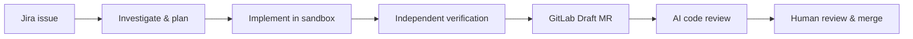
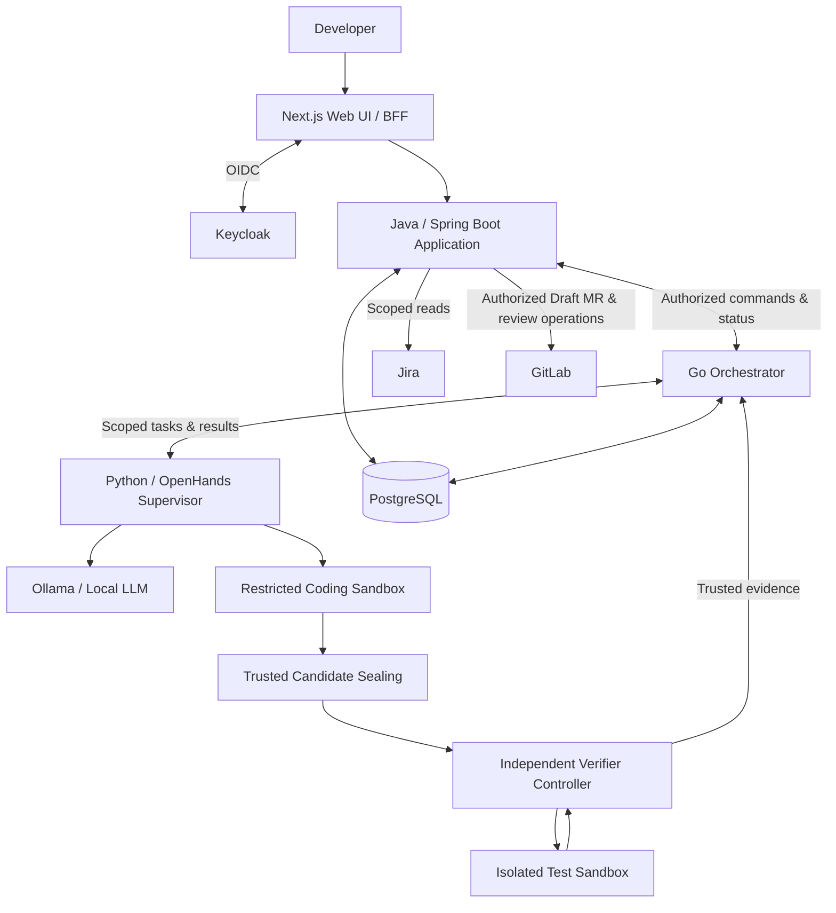

<div align="center">

---

## What is ASEP?

ASEP is a personal engineering project exploring how AI agents can participate in the software development lifecycle **without being trusted to approve their own work**.

The platform brings together issue investigation, planning, sandboxed code changes, independent verification, GitLab delivery, and AI-assisted code review. Its goal is not just to generate patches, but to make the process **traceable, recoverable, and controlled by the developer**.

The first integrated workflow focuses on a single eligible Jira issue and ends with a verified **GitLab Draft MR**. The longer-term platform also includes an AI Merge Request Reviewer and a human-controlled merge process.

## How it works



Internal stages may advance automatically **only within an Owner-authorized policy** and after required evidence checks. ASEP never automatically approves or merges changes.

## Features

- **Jira-driven development** — Select an eligible issue and gather relevant repository context before planning changes.
- **Local coding agents** — Use OpenHands SDK with a local LLM for investigation, planning, and constrained implementation.
- **Isolated execution** — Run agent-controlled commands in restricted workspaces instead of giving generated code access to the host or privileged credentials.
- **Independent verification** — Validate the exact candidate with a trusted controller and protected tests; never treat an agent's `PASS` message as proof.
- **Durable workflows** — Coordinate tasks, retries, cancellation, leases, fencing, and crash recovery through a Go orchestrator backed by PostgreSQL.
- **Controlled GitLab delivery and review** — Create authorized Draft MRs, support evidence-based AI review, and leave approval and merging to humans.

These describe the **target platform capabilities**, not a claim that the entire workflow is already implemented.

## Architecture

ASEP separates application permissions, workflow authority, and agent execution so that a model cannot directly change authoritative state or perform privileged GitLab operations.



| Component                  | Technology                                      | Responsibility                                                         |
| -------------------------- | ----------------------------------------------- | ---------------------------------------------------------------------- |
| Web application            | Next.js, TypeScript                             | UI, authenticated sessions, workflow visibility                        |
| Application & integrations | Java, Spring Boot, Spring Modulith              | Business authorization, Jira/GitLab adapters, trusted external actions |
| Orchestration              | Go, PostgreSQL                                  | Durable workflow state, scheduling, retries, leases, recovery          |
| Agent execution            | Python, OpenHands SDK, Ollama                   | Local reasoning, scoped tools, code changes                            |
| Verification               | Restricted Docker sandboxes, trusted controller | Candidate sealing, protected tests, independent verdicts               |
| Identity & infrastructure  | Keycloak, PostgreSQL, Docker                    | Service identity, data boundaries, isolated runtimes                   |

> **Design boundary:** The diagram shows the intended platform architecture. The existing application can be run locally; the full three-component workflow is still under development.

## Quick start

The commands below start the **existing Spring Boot backend and Next.js frontend**. They do not yet launch the complete Jira-to-Draft-MR pipeline.

**Requirements:** Ubuntu, Java 21, Node.js 24, Corepack, and pnpm 12.11.2. The backend includes Maven Wrapper.

**1. Start the API** (from the repository root):

```bash
cd backend
export JAVA_HOME=/usr/lib/jvm/java-21-openjdk-amd64
export PATH="$JAVA_HOME/bin:$PATH"
./mvnw spring-boot:run
```

API: `http://127.0.0.1:8080` · Health: `http://127.0.0.1:8080/actuator/health`

**2. Start the web app** (in another terminal, from the repository root):

```bash
cd frontend
corepack pnpm install
corepack pnpm dev --hostname 127.0.0.1 --port 3000
```

Open `http://127.0.0.1:3000`.

**Run the existing checks** (from the repository root):

```bash
(cd backend && ./mvnw --batch-mode --no-transfer-progress clean verify)
(cd frontend && corepack pnpm lint && corepack pnpm exec next typegen && corepack pnpm exec tsc --noEmit && corepack pnpm build)
```

For complete development instructions, see the [Local Development Guide](docs/development/LOCAL_DEVELOPMENT.md).

## Project structure

ASEP is organized around distinct application, orchestration, and agent-execution responsibilities. The layout below shows the **intended component homes**, not an exact listing of files currently on `main`. Directories marked `planned` will be established as their code is implemented.

```text
ASEP/
├── backend/                # Java / Spring Boot Application & trusted integrations
├── frontend/               # Next.js web application
├── orchestrator/           # Go workflow engine and PostgreSQL queue (planned)
├── agent-runtime/          # Python / OpenHands adapter and supervisor (planned)
├── verification/           # Trusted verifier and controlled fixtures (planned)
├── contracts/              # Versioned cross-component API schemas (planned)
├── infra/                  # Compose, sandbox and identity config (planned)
├── docs/
│   ├── architecture/       # System architecture and ADRs
│   ├── requirements/       # Product requirements
│   ├── governance/         # Decision records
│   ├── verification/       # Verification specifications
│   └── development/        # Developer setup and conventions
├── .github/workflows/      # GitHub Actions CI
└── README.md
```

## Engineering principles

- **Local-first by default:** no cloud-model fallback in the initial scope.
- **Least privilege:** agent tools and test processes cannot inherit Jira/GitLab write tokens or access the Docker host socket.
- **Evidence before progression:** generated code is independently tested against the exact candidate revision.
- **Recovery over guesswork:** uncertain external outcomes are recorded and reconciled, not blindly retried.
- **Human control:** no autonomous merge, approval, protected-branch writes, or deployment.

Detailed security and execution obligations live in the architecture documentation rather than in this README.

## Documentation

- [Documentation Index](docs/INDEX.md)
- [vNext Product Requirements](docs/requirements/vnext/MVP_SCOPE.md)
- [System Architecture](docs/architecture/vnext/SYSTEM_ARCHITECTURE.md)
- [Execution Contracts &amp; Security Gates](docs/architecture/vnext/EXECUTION_CONTRACTS_AND_GATES.md)
- [Architecture Decisions](docs/architecture/adr/vnext/ADR-VN-01-COMPONENT-BOUNDARIES.md)
- [Local Development Guide](docs/development/LOCAL_DEVELOPMENT.md)

---

ASEP is a **personal, actively developed engineering and learning project**, not a production-ready service.
