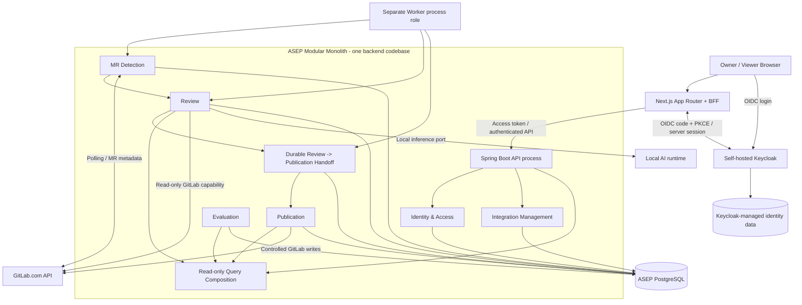
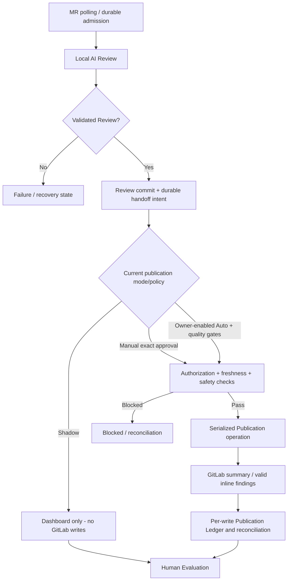

# ASEP M01 - System Architecture (Consolidated Design v0.1)

> **Repository artifact status: OWNER-ACCEPTED CONSOLIDATION (2026-10-18; M00-04).**
> **Architecture decision status:** Final System Architecture Baseline v0.1 explicitly **OWNER APPROVED at design level on 2026-10-18**.  
> **Provenance:** M00-03 Final Architecture Review, Owner approval message, ADR-001/ADR-002 decision content, recovered MD-01..10 and TSE-01..06C notes. This is a newly prepared repository consolidation, **not the missing original standalone ARCHITECTURE.md**.  
> **Implementation/runtime:** NOT VERIFIED. V-01..V-14 remain OPEN/NOT VERIFIED.

## 1. System context

ASEP M01 is a localhost-first, single-host, self-hosted AI Merge Request Reviewer. Owner and Viewer interact through the Web UI. GitLab.com is an external MR source and controlled publication destination. A self-hosted Keycloak provides authentication. A replaceable local AI runtime provides inference. ASEP PostgreSQL owns durable business state while Keycloak owns separate identity data.

**Diagram semantics:** logical module and external boundary diagram, not a deployed network or final process/container topology. ADR-001 requires a separate background Worker process role from API; the exact physical placement of Detection, Publication execution, outbox dispatcher and Keycloak DB is still subject to implementation design. Shared arrows do not grant implicit cross-module database access.

## 2. Non-negotiable boundaries

| Boundary | Required property |
|---|---|
| Browser / Next.js BFF | Confidential OIDC code + PKCE S256 design; tokens server-side; browser receives an opaque HTTP-only session cookie. Session store, TTL, CSRF and revocation implementation deferred. |
| Keycloak / ASEP API | Keycloak authenticates; ASEP/Spring Security enforces business authorization for Owner/Viewer and current policy. JWT validation covers signature/JWKS, issuer, audience and expiry. |
| GitLab read / write | Detection and Review use narrowly scoped read capabilities; only Publication has privileged GitLab comment-write capability. Real PAT least-privilege NOT VERIFIED. |
| Untrusted MR content / AI | MR descriptions, code, diffs and tool outputs are data, not instructions; AI outputs require schema, revision, evidence and location validation. No secrets or privileged actions in model context. |
| Review / Publication | Completing Review records verified findings and durable intent; it cannot itself authorize an external write. Publication independently checks policy, revision, authorization and content. |
| Business state / telemetry | Domain history, workflow state and Publication Ledger are authoritative. Sanitized logs/metrics/traces are diagnostics, not the recovery source. |
| Durable data / temporary context | Minimal Persistence and RET/OPS policies apply. No default long-term repository snapshot, raw diff or cross-run source/context cache. |

**Deployment boundary:** Web UI initially localhost-only. Restricted egress per SEC-009 allows GitLab integration and required local services; no external AI inference or external telemetry by default. Actual network enforcement and isolation are NOT VERIFIED.

## 3. Logical business modules and ownership

| Business module | Owns | Must not own |
|---|---|---|
| **Identity & Access** | ASEP role authorization, policy on allowed actions, Owner-managed provisioning integration with Keycloak | Keycloak raw identity credentials/session implementation; uncontrolled cross-module data access |
| **Integration Management** | GitLab connections, credential references, tracked repositories, removal/config lifecycle | MR polling checkpoints, review findings, Auto-Publish policy decisions, publication ledger |
| **MR Detection** | API polling, revision fingerprinting, durable checkpoints and deduplicated review admission | Source reasoning, publication permission or external write actions |
| **Review** | Context selection/provenance, partial-coverage reporting, local inference adapter, validated findings, durable review lifecycle | Unrestricted GitLab write adapter, policy activation, remote publication effects |
| **Publication** | Owner publication policy and gates, safe rendering/inline anchors, serialized GitLab writes, durable ledger, ambiguous-outcome reconciliation | AI reasoning model state, unvalidated direct Review-to-GitLab shortcuts |
| **Evaluation** | Human Evaluation, independently grounded review quality assessment and metrics | Mutating Review findings or independently authorizing/activating Auto-Publish |

Supporting responsibilities (not extra business-domain modules):

- **Application Coordination:** thin cross-module use-case orchestration via explicit commands/contracts. Does not own all domain state or bypass module transaction authority.
- **Query Composition:** authorized, read-only assembly of module-owned projections for dashboard detail; no unconstrained shared-database reads or 'god dashboard domain' module.
- **Shared telemetry/audit:** sanitized technical diagnostics; durable domain transition history remains module-owned.
- **Data lifecycle coordination:** schedules/delegates cleanup; each domain retains ownership of its expiry semantics.

See [the recovered MD inventory](../sources/recovered/03_Module_Decisions_MD01_MD10_RECOVERED.md) and [Decision Register](../governance/DECISIONS.md). Exact Java package boundaries, interfaces and methods are deferred.

## 4. Primary data flows

### 4.1 Revision-aware MR detection and local Review

1. Detect GitLab MR revisions using polling of ASEP-managed repositories (not external webhooks as required initial trigger).
2. Validate revision fingerprint, checkpoint/pagination/overlap/recovery and deduplicate durable admission.
3. Persist operation state; Worker performs atomic claim with lease/ownership and a fencing token.
4. Fetch authorized MR metadata, diff and minimal relevant source context via read-only GitLab port. Mark collapsed, missing or truncated coverage; do not declare a complete review if context is incomplete.
5. Send sanitized, minimum necessary context to **local** inference through a replaceable port; never provide write credentials.
6. Validate finding schema, technical evidence, determinable location and reviewed revision. A zero-findings response can be valid; hallucinated evidence is not accepted as a grounded finding.
7. Persist final Review state and a durable handoff intent atomically. Worker completion does not imply publication permission.

### 4.2 Publication control

- Auto-Publish is **disabled by default**, per-repository Owner policy, and gated by independent AI quality and publication safety evidence.
- Manual mode uses exact rendered Owner-approved content and reviewed revision. Publishing a changed payload requires renewed approval.
- No more than **three selected inline findings per publication** under CR-001. Valid zero-publishable-finding reviews can create/update the single current ASEP MR summary only when the applicable policy authorizes it.
- Shadow mode neither writes to GitLab nor updates the existing current summary. Enabling policy later does not retroactively publish historical Shadow reviews.
- Published comments must use verified current diff positions. No auto-fallback to generic notes for unanchorable findings. Render/escape to prevent Quick Action injection.
- Keep prior inline discussions; never auto-resolve/delete them. Never approve or merge the MR.
- Each publication write needs minimal ledger tracking. Network failure after GitLab acceptance must be marked unknown/reconciled rather than blindly retried. No external exactly-once assertion.

### 4.3 Viewer and read-side behavior

The BFF authenticates to ASEP API. The API performs backend authorization, then read-only Query Composition fetches retained/sanitized data from Review, Publication and Evaluation contracts. Viewer can read **all retained ASEP-managed repository business information** including unpublished findings and Human Evaluation, but cannot issue workflow commands, mutate policy/config or access raw secrets. A browser refresh or Viewer read does not reset any Owner-inactivity retention clock.

## 5. Durable workflow, failure handling and operational model

ADR-002 approved these logical concepts:

| Mechanism | Design requirement | Verification still needed |
|---|---|---|
| Durable admission | Checkpoints, revision fingerprints, uniqueness/deduplication | Pagination, overlapping polls, restart/reconciliation |
| Atomic job claim | At most one valid active claim/ownership per operation | PostgreSQL locking/transaction behavior |
| Lease / fencing | A late Worker cannot commit after losing ownership | Stale completion test against durable commit boundary |
| Recovery watchdog | Discover expired/abandoned work and safely reschedule | Restart, heartbeat loss, cancellation, retry budgets |
| Durable Review -> Publication handoff | Atomic Review commit + outbox intent; idempotent consumer admission | Duplicate delivery and crash after commit |
| Publication serialization | At most one active Publication operation per MR | Concurrent publish/admission and remote mismatch |
| Ledger / reconciliation | Persist planned/write outcomes and reconcile `UNKNOWN` remote effects | Lost responses, partial comments, summary update failures |

**Logical Review states:** `QUEUED`, `RUNNING`, `COMPLETED`, `RETRY_WAIT`, `RECOVERY_REQUIRED`, `CANCELLING`, `FAILED`, `CANCELLED`, `SUPERSEDED`.

**Logical Publication states:** `PLANNED`, `WRITING`, `PUBLISHED`, `UNKNOWN`, `RECONCILIATION_REQUIRED`, `FAILED`, `BLOCKED`.

These are **design vocabulary, not finalized enums, schemas or migration scripts**. Design does not guarantee exactly-once computation or eliminate the external GitLab freshness TOCTOU race; V-03/V-04 remain OPEN.

## 6. Technology directions and deferrals

| Area | Approved direction | Still deferred / not verified |
|---|---|---|
| Backend | Java + Spring Boot + Spring Modulith (TSE-01) | Framework versions, build, packages |
| Frontend | Next.js App Router + TypeScript (TSE-05) | UI kit, state/query and rendering/cache strategy |
| Persistence | PostgreSQL (TSE-02) | Schema, migrations, JPA/Hibernate vs SQL/JDBC boundaries |
| Background work | PostgreSQL-backed durable jobs/handoff (TSE-03) | db-scheduler PoC vs JobRunr OSS; locking, retry and schedule specifics |
| Review/Publication handoff | PostgreSQL Outbox direction | Transaction/dispatcher/inbox implementations and failure behavior |
| AI inference | Replaceable local Inference Port (TSE-04) | Ollama PoC vs llama.cpp; model, quantization/context, GPU and benchmark |
| Identity | Self-hosted Keycloak (TSE-06A) | Realms/clients, provisioning, security hardening, version |
| Sessions | OIDC Code + PKCE S256, confidential Next.js BFF and Spring Resource Server (TSE-06B) | Session store, refresh/revocation, CSRF, issuer/TLS routing |
| Deployment | Ubuntu single-host; Docker Compose initial candidate (TSE-06C) | Ports, process/container topology, resource limits, actual egress and GPU access |
| DevOps learning | K3s/Kubernetes and Jenkins planned targets | Milestone scheduling and implementations; not required M01 runtime |
| Optional | Rancher lab; Redis only after approved justified use case | No automatic dependency additions |

ADR-001 (approved 2026-10-16) chose modular monolith and separate Workers **before** the Spring Boot framework was selected. ADR-002 likewise approved workflow boundaries before the specific PostgreSQL execution/outbox direction. Never backdate later choices into earlier ADR decisions.

## 7. Security and retention constraints

- **Untrusted input handling:** prompt injection and forged evidence must not escape model/adapter boundaries; generated text has no authority to execute arbitrary shell commands or GitLab actions.
- **Credentials:** GitLab write privileges only in controlled Publication path; secrets never in model prompts, UI or logs. Real fine-grained PAT scope and process/credential isolation NOT VERIFIED.
- **Networking:** GitLab API and necessary local services are permitted; no external AI providers or telemetry by default (SEC-009).
- **Minimal Persistence:** do not retain entire repos, complete raw diff/source snapshots or inference KV/source caches across reviews without separately approved policy.

| Policy ID | Required retention/lifecycle |
|---|---|
| RET-001 / RET-002 | Unapproved or approved-unpublished findings expire after 30 days of meaningful Owner inactivity |
| RET-003 | Published content/evidence 90 days after successful publication |
| RET-004 | Sanitized audit 90 days |
| RET-005 | Minimal publication/reconciliation ledger 365 days, then delete by policy |
| RET-006 | Sanitized logs 30 days |
| RET-007 | Delete expired content/evidence; preserve only minimal audit marker under its own applicable TTL |
| RET-008 | Only meaningful Owner actions reset inactivity; Viewer reads and background polls do not |
| OPS-001 | Cleanup temporary data on completion/cancel/failure; scavenge crash leftovers |
| OPS-002 | Bounded safe retries with MR-version revalidation; CR-001 qualified Auto-Publish is a separately authorized exception to historical no-auto-publication wording |
| OPS-003 | At most one active Review and one active Publication operation per MR |
| OPS-004 | Integration removal deletes local credential, cancels jobs and pending content, retains published history according to TTL |

**Deferred:** expiry for detailed execution-history records and Human Evaluation details, metrics/traces backend TTL, exact cleanup implementation and backup/restore strategy.

## 8. Testing and observability design

- **Architecture/unit:** Spring Modulith dependency verification, JUnit-based domain state tests.
- **Integration/concurrency:** module contracts, PostgreSQL/Testcontainers claim/lease/fencing/outbox tests, GitLab/Keycloak HTTP adapter contracts.
- **E2E:** Owner/Viewer behavior with real auth and safe publication controls, e.g., Playwright.
- **Fault injection:** Worker crash, duplicate outbox delivery, ambiguous/partial GitLab writes, stale revision during publication, cancellation and integration removal.
- **AI evaluation:** independent labeled defects + clean cases, source grounding, precision/recall and latency, reviewed coverage and prompt-injection scenarios.
- **Observability:** separate authoritative domain history/Publication Ledger from sanitized operational logs, metrics and traces. No sensitive payload in trace attributes or high-cardinality metric labels.

Testing architecture direction was approved 2026-10-18; exact test library versions, CI schedule, tooling and numeric quality thresholds remain deferred. A test plan is not a passing test run.

## 9. Verification blockers and residual risk

All V-01..V-14 remain OPEN/NOT VERIFIED. Critical risks include GitLab authenticated API/token restrictions, polling completeness, external TOCTOU publication race, lost-response duplicate prevention, Worker fencing/outbox recovery, Auto-Publish independent safety gates, local model quality, partial context, Keycloak/authorization, egress/prompt injection, TTL enforcement, GPU/VRAM behavior, process isolation and backup/ledger expiry.

Follow [Traceability and Risks](../verification/TRACEABILITY_AND_RISKS.md). Passing architecture review is **not** a substitute for runtime evidence and **does not activate Auto-Publish**.

## 10. Approval and source anchors

**Final Design Owner sign-off dated 2026-10-18** explicitly approved the Final System Architecture Baseline v0.1 at architectural-design level while retaining ADR-001/002, MD-01..10, TSE-01..06C, Requirements v0.2 + amendments, Testing & Observability and Traceability/Risk Backlog. It explicitly **did not** approve M01 implementation, deployment, Keycloak, GitLab runtime, AI quality, deferred choices, or closure of V-01..V-14.

This repository document is a **newly written consolidation**, accepted by the Owner as the repository design baseline on 2026-10-18. It is not a verbatim copy of missing originals or runtime approval. Sources:

- [ADR-001](adr/ADR-001.md), [ADR-002](adr/ADR-002.md)
- [Recovered detailed system design](../sources/recovered/02_System_Architecture_Detailed_Design_RECOVERED.md)
- [Recovered MD-01..10](../sources/recovered/03_Module_Decisions_MD01_MD10_RECOVERED.md)
- [Recovered TSE-01..06C](../sources/recovered/04_Technology_Evaluations_TSE01_TSE06C_RECOVERED.md)
- [Recovered Testing/Observability](../sources/recovered/05_Testing_Observability_v0.1_RECOVERED.md)
- [M00-02 Technical Discovery](../discovery/TECHNICAL_DISCOVERY_REPORT.md)
