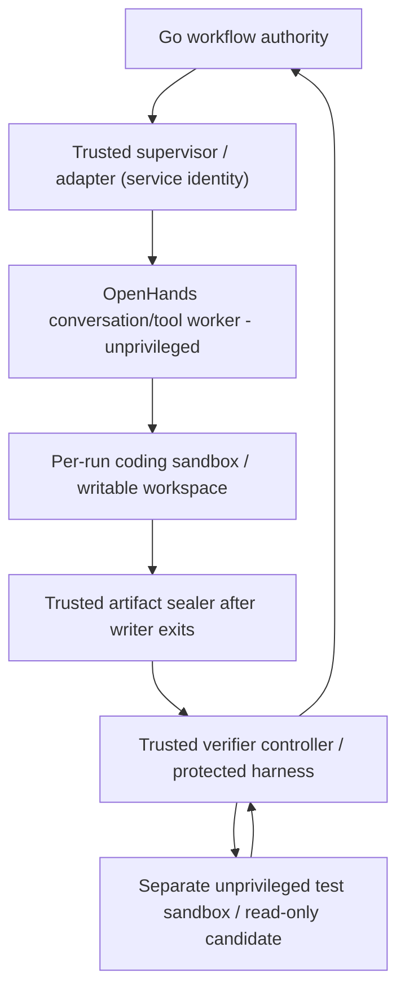

# ASEP vNext — Minimum Execution Contracts and Security Gates

**Prepared:** 2026-10-22; corrected after independent review.
**Status:** ENGINEERING CONTRACT PROPOSAL within Owner-selected P-01/P-02/P-03 and Go/PostgreSQL/Python/OpenHands directions. **No API, SQL, trust isolation, model or GitLab behavior is implemented or verified by this document.**
**Scope:** One eligible ticket, one enrolled test repository, one active workflow, bounded local-only agent and confirmed GitLab **Draft** MR handoff. Detailed fields/algorithms require ticket-specific design, tests and Owner decisions where policy/data privileges change.
**Authority:** This is the **canonical location for vNext execution contract obligations** referenced by the vNext architecture/ADRs/requirements. It does not rewrite M01 ADR-001/002, CR-001 or existing Publication policies.

## 1. Run identity, admission and source provenance

Admission stores `commandId`, canonical payload hash, actor/trigger identity, Jira site/project/issue stable IDs, normalized ticket snapshot/fingerprint, enrolled GitLab project ID, repository/base commit SHA, target branch/observed head, policy ID/epoch and bounded run budget **before** dispatch. Use a trusted snapshot of permitted Jira fields; ticket text and links do not confer authority. Jira's display key or arbitrary `updated` timestamp alone is not assumed to be a reliable business revision. Exact fingerprint and API semantics are **OPEN**.

- A transport replay with the **same command ID and same normalized payload** returns the existing logical response. The same ID with a different payload is a **conflict**, not an authority extension.
- Distinct command IDs must not start two **active** runs for the same enrolled Jira issue/repository subject under the approved concurrency profile, regardless of source/policy changes. Use a durable uniqueness rule; distinguish intentionally authorized reruns **after terminal state** from accidental redelivery.
- Reject missing mappings, unauthorized ticket classes, unavailable policy/permissions, conflicting repository base or unresolved active execution. Initial slice uses manual Owner selection; automated intake/polling is deferred.
- Bind every artifact and later external operation to the recorded ticket snapshot and source/base/candidate/target revision identities; source fingerprint changes must be classified, not assumed harmless.

## 2. Finite state transitions, attempts and durable transactions

The following is a *small candidate vocabulary*, not a finalized DB enum or an excuse to build a general workflow language. Go remains the **sole transition writer**.

| Run/stage boundary | Allowed next outcome | Required durable decision |
|---|---|---|
| `ADMITTED` | `INVESTIGATING`, `BLOCKED`, `CANCEL_REQUESTED` | Eligible scope, policy epoch, base/ticket snapshot and task intent exist |
| `INVESTIGATING` | `PLANNING`, `BLOCKED`, `ESCALATED`, `CANCEL_REQUESTED` | Scoped evidence/coverage and limitations from inspected revision |
| `PLANNING` | `IMPLEMENTING`, `BLOCKED`, `ESCALATED`, bounded `PLANNING` rework, `CANCEL_REQUESTED` | Allowed paths/tools, test obligations, bounded plan and current coding policy |
| `IMPLEMENTING` | `VERIFYING`, bounded rework, `FAILED`, `CANCEL_REQUESTED` | Candidate writer stopped; trusted-sealed manifest/candidate is available |
| `VERIFYING` | `REVIEWING`, bounded `IMPLEMENTING` rework, `BLOCKED`, `CANCEL_REQUESTED` | Protected independent test evidence for exact candidate/profile, not agent self-report |
| `REVIEWING` | `DELIVERY_PENDING`, bounded rework/replan, `BLOCKED`, `ESCALATED`, `CANCEL_REQUESTED` | Independent review rubric, security blockers, current authorization and resource limits |
| `DELIVERY_PENDING` | `COMPLETED_DRAFT_MR`, `RECONCILIATION_REQUIRED`, `BLOCKED`, `CANCEL_REQUESTED` | Separate confirmed branch and Draft MR operations; no inferred CI/merge success |
| `CANCEL_REQUESTED` | `CANCELLED` after controlled termination; unresolved remote operation still tracked separately | Invalidate future task/write authority; terminate descendants; preserve remote facts |
| Terminal: `COMPLETED_DRAFT_MR`, `BLOCKED`, `ESCALATED`, `FAILED`, `CANCELLED`, `SUPERSEDED` | No automatic reactivation | New authorized command/rerun policy required; reconciliation facets may still resolve |

`RECONCILIATION_REQUIRED` may be represented as an operation facet or execution state; **remote UNKNOWN must never be silently mapped to failed/no-effect**. A terminal/cancelled run may still have an externally confirmed operation that completes reconciliation later. The state model must prevent false claims of undoing remote effects.

- A transition validates expected `runVersion`, `attemptId`, active policy epoch, source/candidate identity and trusted gate inputs; it **atomically commits** new state, budget debit, next stage task and necessary outbox intent in a **single Go-owned PostgreSQL transaction**.
- `StageAttempt` counts semantic rework/replan; `TaskDelivery` is transport ownership. A reclaimed delivery increases `leaseEpoch`, **not automatically** the semantic attempt/budget counter. Budgets survive restarts and retries.
- Task claim and heartbeat use short database transactions, database-time lease expiry and compare-and-set state/version/epoch. **Never hold locks throughout model/tool execution.** Reject result/heartbeat after lease expiry even when no second worker has claimed.
- Cancellation and gate/transition commits must be serialized by a durable decision so a race cannot create unauthorized successor tasks. An already in-flight remote write may still need reconciliation.
- Outbox dispatch/inbox acknowledgement is at-least-once: dedupe on stable message/operation ID **and expected payload hash**, including after crash-before-ACK and out-of-order callbacks. Timeouts mean UNKNOWN outcome, not failed transaction proof.

## 3. Typed task, result and independent evidence binding

| Contract | Minimum bound identity/meaning | Who may assert/validate it |
|---|---|---|
| `WorkflowCommand` | version, command ID, canonical payload digest, authenticated actor/trigger, allowed ticket/repo, expected policy epoch | Java authorizes; Go admits/replays idempotently |
| `AgentTask` | run/stage/attempt/task ID, lease epoch, normalized ticket/base references, role, allowed capabilities/model, workspace scope, deadline/budget | Go issues; trusted supervisor checks; agent is untrusted |
| `AgentResult` | same task/attempt/epoch, declared result, bounded diagnostic/coverage, proposed artifact reference and usage | Agent may propose only; Go rechecks lease/run/version/policy |
| `SealedCandidateManifest` | repo/base SHA, candidate tree/commit/hash, paths/size/type allowlist, producer attempt, trusted seal receipt | Trusted artifact controller recomputes and seals **after writer termination** |
| `VerificationEvidence` | exact manifest digest, verifier profile/harness/image digest, discovered/executed/skipped/failed tests, exit/timeout, logs digest, controller-issued receipt and receipt time | Trusted verifier controller derives from independently observed execution, never string `verifiedBy` from agent |
| `ExternalActionIntent` | operation ID/body hash, enrolled repo, source branch, candidate commit/manifest, expected target head, policy epoch, trusted evidence ID, fixed allowed action | Go authorizes intent; Java executor reauthorizes **at execution time** |

Identity of the caller is established at a **trusted service API boundary**, not a `verifiedBy`, `authorizationProofRef` or `success=true` field supplied by an agent. Bind receipts to task/run/attempt/profile/artifact and reject spoofed, replayed, expired, cross-run or contradictory evidence. HTTP schema validation is necessary but **never sufficient** for authority.

## 4. Agent and independent verifier privilege placement

The process diagram below is a **required trust topology to design/verify**, not a claim OpenHands already deploys this way:

- Pin an actual OpenHands SDK/workspace/Agent Server mode and confirm **which process** receives internal tokens, executes tools, persists conversations, and can access container-management facilities; do not assume local SDK mode is isolated just because tools are in Python classes.
- No Jira/GitLab credentials, orchestration DB password, privileged internal-service token, Docker host socket, unrestricted host filesystem/network or hidden test harness in tool/test subprocesses. Controllers may provision sandboxes **without exposing provisioning sockets/secrets to children**.
- Run **candidate-controlled build, imports, plugins and tests inside a separate restricted verifier sandbox**, even though the verifier controller is trusted. A successful exit code alone does not prove that meaningful tests executed: check discovery, disabled/skipped tests, altered test configuration, timeouts and known baseline-fail/candidate-pass fixture or protected external behavior oracle where applicable.
- The candidate writer must stop, then trusted code recomputes the source tree/manifest digest; verification uses an immutable/read-only snapshot. Do not deliver if later writes change that digest, including via symlink/path traversal or background child process.
- Scope SDK transcript, tool log, temp/cache and model-condenser output locations to per-run lifecycle; local-only applies to **all** model calls, auxiliary agents and plugins. Prompt injection inside Jira/source/`AGENTS.md` never grants new capabilities.

## 5. Code Delivery — two recoverable privileged external operations

**Step A: branch push.** Executor receives a committed intent binding enrolled GitLab project, deterministic scoped branch ownership, base SHA, exact candidate commit/tree/manifest, expected target head and policy epoch. Before writing, check branch/target permissions, CI/build/deploy/secret-trigger risks, and current authorization. Do not force-push or overwrite a branch that does not match ASEP's own recorded ownership/candidate. Record `PLANNED → IN_PROGRESS → CONFIRMED | UNKNOWN | BLOCKED`. A lost push reply triggers remote head/ownership lookup before retry.

**Step B: Draft MR creation.** Only after confirming branch head matches the verified candidate may executor build a **controlled Draft title/body** using an allowlisted template and GitLab Quick Action neutralization. Check the enrolled target branch/revision and current policy; create/find the Draft MR via scoped GitLab capability. Confirm remote project, source/target, current head and Draft state. Persist distinct MR sub-operation `CONFIRMED | UNKNOWN | BLOCKED`; if reply is lost, query for a matching tracked operation/remote identity first. Branch name or MR title **alone is not sufficient** to establish ownership; do not assume GitLab supplies a generic exactly-once create-MR idempotency key.

- Push and MR creation are **not atomic**. `branch confirmed / MR UNKNOWN` remains a partial, auditable outcome. If remote lookup yields conflicting branch ownership, multiple candidate MRs or insufficient evidence, **BLOCK/ESCALATE; do not blindly retry, delete or overwrite**.
- GitLab **Draft MRs may still trigger pipelines**. Before push, check enrollment of CI configs, runners, branch/pipeline rules, protected variables and deployment credentials. Unauthorized CI-induced deploy/secret use blocks Code Delivery. Human merge does not retroactively undo pipeline effects.
- Revalidation reduces but does not eliminate remote TOCTOU race. If ticket/target/policy changes before the write, BLOCK/revalidate; if a request was already sent, retain actual effect/UNKNOWN and report residual race instead of claiming GitLab supports internal fencing.
- On integration removal/revocation, **deny all new mutations immediately**, delete write credential per approved OPS policy, cancel pending work, preserve only necessary unresolved operation metadata; if no read capability remains, mark **MANUAL_RECONCILIATION_REQUIRED**. Do not retain/reuse revoked write tokens secretly or claim cancellation reverses remote writes.

## 6. Internal identities, PostgreSQL ownership and read models

- Java Application, Go Orchestrator, Trusted Action Executor (if distinct), Keycloak and migration roles require separate least-privilege identities. Python supervisor requires a narrowly scoped service identity but **child tools/verifier sandboxes do not inherit it**.
- Every internal endpoint validates caller identity, audience/capability/scope, task ownership and current policy as applicable; the exact scoped-token/Keycloak-service-account mechanism is OPEN. Network location or Docker network membership is not authentication.
- PostgreSQL runtime roles cannot create objects or write another owner's schemas; use explicit grants and safe `search_path`. Schema migrations require versioned coordination with in-flight tasks and API/worker compatibility. No cross-owner direct writes as an integration shortcut.
- Command admission and Go outbox transaction are Go-local; Java executor commits its operation/inbox record **before ACK**. Retry callbacks/status queries are idempotent. Read models tolerate projection lag and offer authoritative status lookup/repair; they never independently advance workflow state.
- After database restore that may lack recent external operation records, **freeze new delivery and reconcile remote effects before resuming**, rather than assuming GitLab effects rolled back. Exact backup/restore policy remains OPEN.

## 7. Data access, lifecycle and security-policy gates

| Data class | Interim restrictive treatment (not a final retention approval) | Owner policy required before real sensitive use |
|---|---|---|
| Jira ticket fields/ADF/PII | Only bounded normalized authorized fields in synthetic PoC; do not follow arbitrary URLs/attachments | Enrolled Jira scope, explicit Java-only read egress, purpose/visibility/TTL/deletion |
| Worktrees/source/dependency data | Per-run temp area, sandbox access only, pinned fixture dependencies, cleanup/scavenge | Real repository authorization, optional cache permission and resource limits |
| OpenHands conversations/model/tool logs | Per-run ephemeral or sanitized minimum; inspect all SDK persistence paths | Visibility, access, retention and deletion policy |
| Candidate/test evidence | Seal exact candidate, keep until downstream verifier/delivery acknowledges; avoid raw full-source archival | Handoff/TTL, protected-test access, evidence and restore policy |
| Code Delivery ledger/UNKNOWN records | Minimal IDs/heads/status needed for dedupe, reconciliation and human intervention | Ledger retention and integration-removal/backup treatment |

**VNX-SEC-EGRESS-01 remains a proposed vNext-only exception**, not a silent expansion of M01 SEC-009: permit only the trusted Java adapter to read from Owner-enrolled Jira Cloud API origins with restricted methods/scopes/redirects and bounded data. Until adopted, **synthetic fixture only**; agent, sandbox, verifier child and local model have no Jira egress. No cloud inference, telemetry or unrestricted runtime downloads. Model/image/package provisioning is a separate controlled step.

## 8. Stage-specific evidence gates and evaluation rubric

| Stage | Minimum testable evidence / disposition | Do not mistake for proof |
|---|---|---|
| Investigation | Inspected file/revision references, missing-context disclosure and relevance to ticket | Unsupported confident diagnosis |
| Planning | Bounded change-intent, allowed paths, expected protected acceptance behavior and assumptions | Long textual plan or model agreement |
| Implementation | Sealed candidate manifest after writer terminated, changed-path limits and reproducible patch reference | Agent `SUCCESS` or self-reported digest |
| Independent Verification | Controller-issued results for exact candidate/protected test profile, meaningful discovered tests, failures/skips/timeout and baseline comparator when relevant | Agent tool output, exit 0 with no tests collected |
| Independent Review | Fresh-session/role independence, explicit security/scope blockers and justified findings against artifact/test evidence | A second LLM agreeing; independent model is heuristic, not correctness guarantee |
| Delivery | Confirmed branch head and Draft MR exact candidate, two-step ledger, authorized CI risk profile | Merely posting MR URL; CI green/merged/task resolved |

Exact thresholds, budgets, allowed changed paths, CI/rework profile, risk appetite and real-data policies are **OPEN** until the relevant Owner decision and reproducible benchmark/fault results. Fail closed on missing gate prerequisites, do not guess a PASS.

## 9. Required verification and deferral

Before relevant **synthetic execution**: pin OpenHands/model/tool/sandbox image versions; enforce token/process separation and protected verifier harness; define runnable behavior oracle and bounded budgets. Before **real Jira/repository data**: policy/egress/TTL/access gates. Before **remote writes**: test branch/MR ledger, CI threats, freshness, unauthorized body fields, lost-response/revocation. See [verification and faults](../../verification/vnext/TRACEABILITY_AND_RISKS.md) and [roadmap gates](../../governance/vnext/ROADMAP_PROPOSAL.md).

This file defines contract **intent and validation obligations**. Implementation SQL, exact transport schemas, concrete numeric thresholds, real token scopes and observed behavior remain **NOT VERIFIED**. No runtime PoC, migration, merge or protected-branch action is authorized merely by accepting this document.
