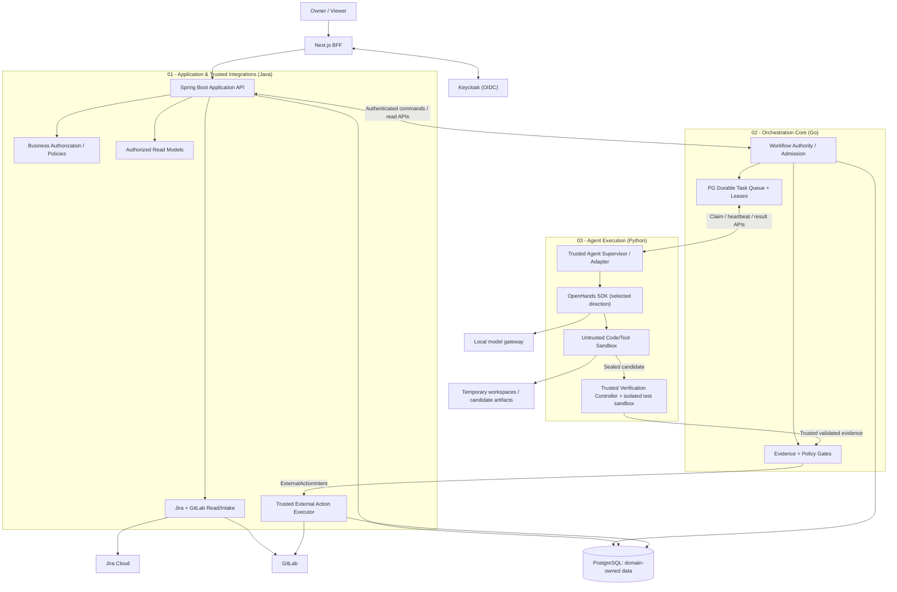
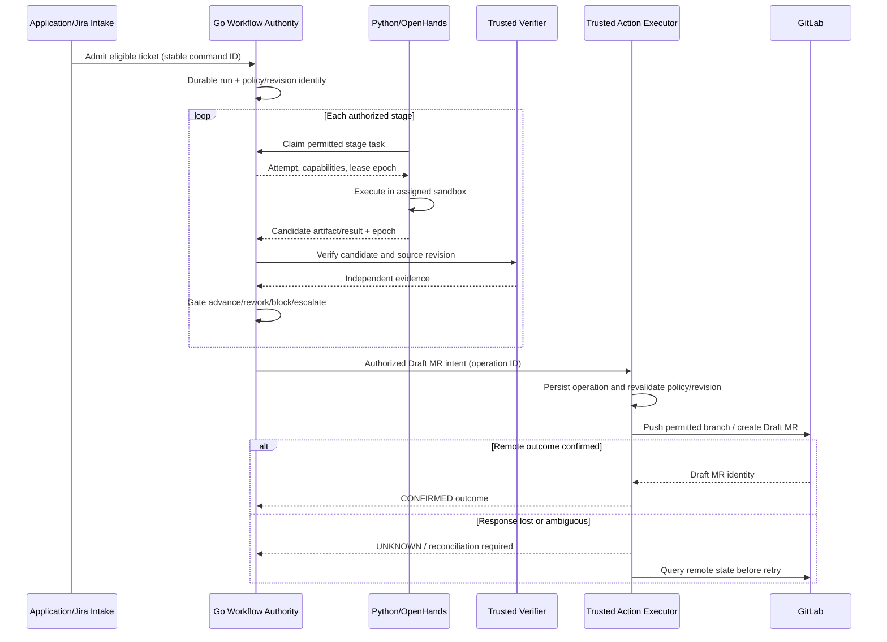

# ASEP vNext — Three-Component System Architecture

**Prepared:** 2026-10-22
**Status:** OWNER-DIRECTED vNext ARCHITECTURE PROPOSAL (2026-10-22); not deployed and NOT RUNTIME VERIFIED. Apply/adopt in the live repository before PoC/implementation.
**Decision context:** P-01/P-02/P-03 accepted, Go custom PostgreSQL and Python/OpenHands Owner-selected for vNext; implementation/schema/security feasibility remains OPEN.
**Scope boundary:** This is the bounded vNext Jira-to-Draft-MR proposal. Effective M01 requirements/Publication rules remain authoritative for the existing reviewer until a separately approved change applies.

## 1. Logical component model



Diagram shows **logical responsibility**, not proof of network and runtime isolation. The **trusted verifier controller** chooses a protected test profile, while the actual build/tests executing candidate-controlled code run in an **unprivileged second sandbox**. The controller and supervisor retain credentials outside child tool/test processes. No direct Go/Python GitLab privileged writes.

## 2. Authority and boundaries

| Logical owner | Authoritative data / decision | Denied capability |
|---|---|---|
| Application (Java) | Owner/Viewer access, repo/integration config, user/session business authorization, policy config, Jira/GitLab adapters | Workflow completion decisions; arbitrary SQL write to orchestrator domain |
| Go Orchestrator | WorkflowRun, StageAttempt, retry/rework budgets, lease/fencing ownership, transition/evidence gate, durable task queue, authorized external-action intent | Possession of GitLab/Jira write credentials or AI-generated arbitrary commands |
| Python Agent Supervisor | Mapping typed tasks into SDK role/model/workspace, tool lifecycle, result formatting and sandbox launch | Workflow DB access, unrestricted credential access, bypassing gates |
| Restricted sandbox | Assigned source/workspace and allowed local tools | Host user home, Docker socket, privileged tokens, PostgreSQL, unrestricted egress, protected test fixtures |
| Trusted Verification | Controller seals/checks candidate, chooses protected oracle and attests sandbox results | Run candidate build/tests with controller credentials or accept self-reported PASS |
| Trusted External Action Executor (Application) | Serialized privileged GitLab operation, independent policy/freshness checks, operation outcome & reconciliation | Accept free-form shell or unrestricted model directives |
| Keycloak | Identity, authentication and IdP session lifecycle | ASEP business workflow policy authority |

**Existing M01 modules:** Review owns validated M01 finding business data; Publication retains its own comment publication policy and ledger. This vNext system design **does not** automatically move old M01 domain ownership into Go or Python.

## 3. Data architecture — one PostgreSQL engine initially

```text
postgresql server
  asep database
    app schema              -- repo config, authorization, integration metadata
    orchestration schema    -- workflow runs, attempts, tasks, leases, transitions
    integration_ops schema  -- trusted external-operation records / new Code Delivery ledger
    (M01 existing schemas)  -- unchanged until reviewed for migration
  keycloak database         -- identity provider-owned, separate runtime DB role
```

- Schemas are organizational and permission boundaries **only when paired with strict roles/grants and safe `search_path`**; PostgreSQL instance remains a shared failure and resource domain.
- Separate runtime roles with least privileges; migrations use distinct privileged roles and coordinated schema compatibility/versioning for in-flight tasks. Runtime accounts cannot create arbitrary objects or use superuser permissions. Python/sandboxes have no direct business database accounts.
- No arbitrary cross-schema writes or cross-component foreign key coupling. Cross-owner references use stable IDs and validation/read APIs.
- Avoid premature MariaDB, Redis, RabbitMQ or separate database instances. Revisit if isolation, operations, performance or ownership evidence warrants it.
- PostgreSQL task queue is a small Go-owned implementation, **not** a general purpose BPMN/workflow designer. River OSS/Temporal are deferred alternatives.
- Durable metadata is distinct from temporary source files/diffs/agent transcripts. New artifact retention rules are OPEN; do not silently inherit M01 finding TTLs.

## 4. Communication protocol — contract-first, simple transport

| Direction | Proposed transport | Semantics |
|---|---|---|
| Next.js BFF ↔ Spring Boot | Authenticated HTTP | Browser session remains opaque/HTTP-only; backend reauthorizes every request |
| Spring Boot → Go | Internal authenticated REST/JSON | `WorkflowCommand`, `commandId`, `expectedPolicyVersion`; idempotent admission |
| Go → Spring Boot | Internal authenticated read/command APIs | Read policy snapshot/current authorization, publish external-action intent; no direct schema sharing |
| Python Agent Supervisor → Go | Internal authenticated REST pull/heartbeat/result | Go performs atomic SQL claim and fencing; Agent cannot claim via database |
| Go → External Action Executor | Durable intent/outbox + authenticated HTTP | Executor persists idempotent operation before reporting acceptance |
| Executor → Go | Authenticated outcome callback + status query | Duplicates tolerated; `UNKNOWN` requires reconciliation |
| Python Agent Supervisor → OpenHands | In-process Python adapter candidate | SDK implementation details do not leak into `AgentTask`/`AgentResult` |
| Sandbox/Verifier → artifact store | Restricted scoped artifacts | Trusted runner validates source revision and digest |

REST/JSON is a **candidate**; gRPC is deferred absent a demonstrated need. All contracts must be versioned and schema-validated; timeouts do not imply remote failure or authorization.

## 5. Minimum typed contracts (logical fields, not finalized API schemas)

### `WorkflowCommand`

`schemaVersion`, `commandId`, `actorOrTrigger`, `ticketRef`, `repositoryRef`, `sourceRevision`, `expectedPolicyVersion`, `requestedOperation`, `correlationId`.

### `AgentTask`

`schemaVersion`, `taskId`, `workflowRunId`, `stage`, `attemptId`, `leaseEpoch`, `sourceRevision`, `workspaceRef`, `role`, `allowedCapabilities`, `modelPolicy`, `deadline`, `budget`, `correlationId`.

### `AgentResult`

`schemaVersion`, `taskId`, `attemptId`, `leaseEpoch`, `status`, `candidateArtifactRef`, `candidateDigest`, `coverageLimits`, `diagnosticsRef`, `usage`, `failureClass`.

### `VerificationEvidence`

`verificationId`, `runId`, `attemptId`, `candidateManifestDigest`, `baseSha`, `verificationProfileDigest`, `testSuiteVersion`, `testDiscoverySummary`, `exitStatus`, `logSummaryRef`, `coverageLimits`, `trustedVerifierIdentity`, `createdAt`. Fields such as `trustedVerifierIdentity` are **server-derived from authenticated execution**, not accepted as an agent-supplied `verifiedBy` claim.

### `ExternalActionIntent`

`operationId`, `workflowRunId`, `allowedOperation`, `repositoryRef`, `sourceBranch`, `targetBranch`, `baseCommitSha`, `candidateCommitSha`, `candidateManifestDigest`, `expectedTargetHeadSha`, `policyEpoch`, `verifierEvidenceId`, `correlationId`. The authenticated executor independently revalidates its policy/authority; a string `authorizationProofRef` is insufficient.

**Key invariant:** a valid schema or LLM response is **not** authorization. Ownership/fencing/revision/policy are verified by trusted code at durable commit and external write boundaries.

## 6. Workflow and task state are different

- `WorkflowRun` is the overall Jira→Draft MR business execution.
- `StageAttempt` tracks a semantic attempt and correction/replanning budgets.
- `TaskDelivery` tracks one worker lease; `leaseEpoch` changes on reclaim without necessarily increasing semantic retry count.
- `ExternalOperation` tracks remote side-effect lifecycle (`PLANNED`, `IN_PROGRESS`, `CONFIRMED`, `UNKNOWN`, `RECONCILIATION_REQUIRED`, `FAILED/BLOCKED`) with **separate records for branch push and Draft MR creation**; remote writes are not one transaction.

Only Orchestrator may commit stage progress after current-policy and trusted-evidence validation. Tool/model-generated results are proposals, never an authoritative workflow transition. A lost lease or cancelled workflow invalidates late submissions; sandbox termination/cleanup must be enforceable independently of Python cancellation tokens.

## 7. End-to-end sequence and failure boundaries



- **Admission duplicates:** same stable ticket/revision/policy key cannot produce unintended duplicate active execution; exact uniqueness rule to be finalized.
- **Crash after commit before ACK:** retried command returns existing durable result.
- **Lease expiration:** reclaim via atomic SQL; stale workers are fenced at commit boundary.
- **Source revision changed:** block/revalidate at relevant gates; no silently stale GitLab write.
- **Remote timeout:** ambiguous GitLab result remains UNKNOWN, never blind retry.
- **CI:** Draft MR confirmed, CI pending, CI passed and human merged are distinct verified states. CI feedback loop extent is an OPEN acceptance decision.

## 8. Authentication, sandbox and egress

- Keycloak-based user OIDC/BFF architecture is retained; internal machine identity is **not yet selected** (scoped credentials vs Keycloak service accounts). Do not trust a container simply for being on the same network.
- Service roles and DB grants must match ownership table; no shared superuser for runtimes.
- Trusted Agent Supervisor's credentials must be inaccessible to shell/tools executed in the sandbox, including by filesystem, environment, sockets or metadata endpoints.
- Sandbox environment is isolated per task and not allowed to access host secrets, Docker socket, DB, Jira/GitLab privileged endpoints or non-allowlisted network destinations.
- All ticket descriptions, repository code, diffs, tests, tool outputs and model outputs are **untrusted content**. Agent-reported instructions cannot expand tool permissions or external-action authority.
- Local model inference only initially; Claude escalation requires future approved CR and must not be used as automatic fallback.
- Independent verifier uses protected test inputs unavailable for agent modification and rechecks digest/revision; actual isolation is NOT VERIFIED.

## 9. Retention, observability and audit

- Preserve historical **M01** RET-001..008, OPS-001..004 and SEC-009 exactly within approved scope.
- New Jira/patch/workspace/agent transcript and Code Delivery ledger data types need explicit new retention decisions; do not infer arbitrary numbers.
- Runtime operational logs/traces must be sanitized, are **not** workflow authority, and should carry `correlationId`, `workflowRunId`, `attemptId`, operation outcome/failure class.
- Do not persist full raw source, agent prompts or complete transcripts by default; clean temporary data on task completion, cancel and failure and run crash scavenging.
- Backup/restore capability for authoritative workflow data and externally observable operation history remains OPEN and must be assessed before real continuous execution.

## 10. Deployment direction and limits

Initial deployment candidate: one Ubuntu host; containerized Next.js, Spring Boot Application, Go Orchestrator, Python Supervisor, PostgreSQL and Keycloak with deliberately isolated sandbox processes; host-native Ollama can be examined later. Exact GPU passthrough, image hardening, inter-service TLS/auth, network isolation, resource budgets and host memory concurrency are **NOT VERIFIED**. This is not a Kubernetes or microservices scalability claim.

## 11. Contract and threat-model readiness

The [canonical minimum execution contracts and gates](EXECUTION_CONTRACTS_AND_GATES.md) record admission/transition/fencing and transaction rules; actual OpenHands vs controller/tool/verifier process placement; sealed candidate and authenticated evidence; per-step push/MR ledger/reconciliation; service identity; Jira read egress and CI-trigger security. **They are design prerequisites for execution**, not claims that APIs, policies, sandbox isolation, permissions or local-model quality are verified.

- **Source/base/candidate/target** are distinct: Jira snapshot; repository/base commit; candidate commit/tree/manifest; expected GitLab target HEAD. Evidence must describe the exact candidate that is later pushed.
- **Independent verification is not merely a second LLM opinion**. Run candidate tests under a protected controller in a separate sandbox with no secrets; no-tests-collected or disabled/altered harness must not be PASS.
- **Service identities are authenticated**. Neither same-host networking nor a schema-valid `verifiedBy` field authorizes a transition or remote write.
- **Go authority remains local to PostgreSQL transactions**; GitLab commits/MRs require reconcilable remote operation status and current executor authorization. If authorization is revoked before resolution, no new writes; if read credentials no longer exist, manual reconciliation remains possible.
- **CI can be triggered by push/Draft MR even before human merge**. Repository enrollment must examine deploy jobs, runners, secrets and sensitive CI/build files before external delivery.

## 12. Decision map / verification

- vNext ADR-VN-01: component/runtime boundary evolution relative to ADR-001.
- vNext ADR-VN-02: Go durable queue/workflow engine relative to ADR-002, TSE-03.
- vNext ADR-VN-03: Python/OpenHands adapter, scoped sandbox and local model.
- vNext ADR-VN-04: PostgreSQL ownership, roles and internal REST contracts.
- See `../../verification/vnext/TRACEABILITY_AND_RISKS.md` for OPEN verification obligations and original V-01..V-14 relationship.
- See `../../governance/vnext/CHANGE_PROPOSAL.md` for the Owner-accepted P-01/P-02/P-03 scope and policy changes.
