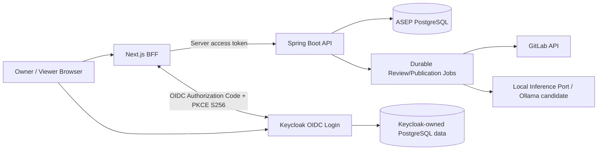

# 02 — ASEP M01 System Architecture Detailed Design (Recovery Notes)
**Status:** Architecture design approved 2026-10-18; **this file is a structured reconstruction, not verbatim standalone ARCHITECTURE.md.**
**Source anchors:** M00-03 Final Architecture Review (`Pasted text(9).txt`), M00-03 Execution Summary (`Pasted text(6).txt`), approved ADR-001/002 and MD decisions.

## 2.1 System context
Actors: Owner and Viewer. External systems: GitLab.com API; Keycloak identity provider; local inference runtime. Persistent resources: ASEP PostgreSQL business datastore and logically separated Keycloak-owned identity store. UI: Next.js App Router with confidential-client BFF. Backend: Spring Boot modular monolith, with HTTP API and justified separate background Worker processes.

This is **logical**, not a verified or final container/process topology. The actual process boundaries and network access require verification.

## 2.2 Trust boundaries
1. Browser/Next.js: browser receives opaque, HTTP-only session cookie; OIDC access/refresh tokens stay in protected server-side storage; exact session store, TTL, key rotation and CSRF protections are design obligations not finalized.
2. Keycloak/ASEP: Keycloak handles authentication, identity, credentials, sessions. ASEP owns Owner/Viewer business authorization and Owner-controlled provisioning integration. Spring Boot validates JWT signature/JWKS, issuer, audience and expiration; application permissions enforced server-side.
3. GitLab/ASEP: GitLab descriptions, repository code, diffs and API outputs are **untrusted inputs**, never instructions with authority. Read/capability-specific integration separated from privileged write operations.
4. Local AI: inference on source/context stays local. Model outputs must be validated and cannot directly invoke privileged GitLab writes or execute arbitrary commands; runtime egress/security isolation NOT VERIFIED.
5. PostgreSQL: persistence for minimum durable business state only; no long-term raw source/diff/prompt persistence without specific approved policy.
6. Publication: Review completion and local inference success do not authorize an external write. Publication revalidates authorization/current Owner policy, freshness, selected payload and safety/evaluation gates.

## 2.3 Six logical business modules and interactions
- **Identity & Access:** Owner/Viewer authorization, account provisioning orchestration with Keycloak; backend enforcement.
- **Integration Management:** GitLab connections, credential references, tracked repository configuration, lifecycle/removal.
- **MR Detection:** GitLab polling, revision fingerprinting, durable checkpoints and admission.
- **Review:** context preparation/provenance, bounded local AI inference, findings validation, durable Review state.
- **Publication:** selected content rendering, per-MR serialization, freshness/policy validation, GitLab write adapter, Publication Ledger, reconciliation.
- **Evaluation:** independent AI quality assessments and Human Evaluation.

Supporting responsibilities: thin Application Coordination, read-only Query Composition, domain-owned execution histories, shared sanitized telemetry/audit implementation and lifecycle coordination.

## 2.4 Primary data flows
**Detection/Review:** polling → durable revision check/checkpoint → atomic Review admission → Worker claim+lease/fencing → GitLab context via read port → local inference via Inference Port → finding schema/evidence/provenance validation → durable Review result.
**Handoff:** Review state update and outbox intent are atomic; downstream admission must be idempotent; exact Outbox implementation deferred.
**Publication:** Owner policy/manual approval → current revision/policy/safety gate validation → serialized Publication operation → GitLab write(s) → per-write ledger outcome; ambiguous writes require remote reconciliation, not blind retry.
**Read side:** authorized Next.js UI → Spring Boot composition layer → module-owned read contracts for Review, Publication, Evaluation; subject to retention and Global Full Read-Only Viewer amendment.

## 2.5 Workflow states & recovery
Logical Review states discussed: queued, running, retry-wait, recovery-required, completed, failed, cancelled, superseded. These are conceptual, not exact schema/enum. Atomic claim, lease, fencing token, watchdog/recovery reclaim, bounded retry, cancellation, and reconciliation must prevent stale commits and false success.
GitLab API external write cannot participate in a local DB transaction. A lost response implies UNKNOWN outcome; reconcile before retry. No external exactly-once or absolute zero-race guarantee is asserted.

## 2.6 Retention
Approved: unpublished findings 30-day meaningful Owner inactivity; published evidence/content 90 days after publication; sanitized audits 90 days; minimal Publication Ledger 365 days; sanitized operation logs 30 days; temporary source/diff/context deleted after job completion/failure/cancellation, plus crash scavenging. Viewer reads and background polling do not reset inactivity. Detailed execution/Human Evaluation TTL remain DEFERRED.

## 2.7 Deployment direction
Initial single Ubuntu host with Docker Compose candidate for Next.js, Spring Boot API/Worker, Keycloak, PostgreSQL; host-native Ollama first PoC candidate. Distinct Keycloak and ASEP DB ownership/users; no assumption of shared unrestricted DB access. Containerized local GPU inference alternative requires actual passthrough test; Keycloak OIDC issuer/hostname/TLS/reverse-proxy semantics need validation. Jenkins and K3s planned learning targets; Rancher optional; Redis no runtime dependency absent approved use case.

## 2.8 Cross-cutting quality
Architecture/module boundaries tested with Spring Modulith verification, Java unit/module tests, PostgreSQL/Testcontainers concurrency tests, GitLab/Keycloak stub contracts, Next.js Playwright E2E, failure injection, separate AI evaluation. Domain history and Publication Ledger are business truth, not traces/logs. Telemetry must be sanitized and governed by retention.

## 2.9 Explicit implementation unknowns
Database schema/ORM, scheduler/outbox implementations, models/runtime, API/Worker process authority separation, GitLab real token capabilities, callback publication race, Keycloak session/provisioning details, backup/restore, telemetry storage, numeric quality/SLO thresholds remain deferred or open. V-01..V-14 remain OPEN.
