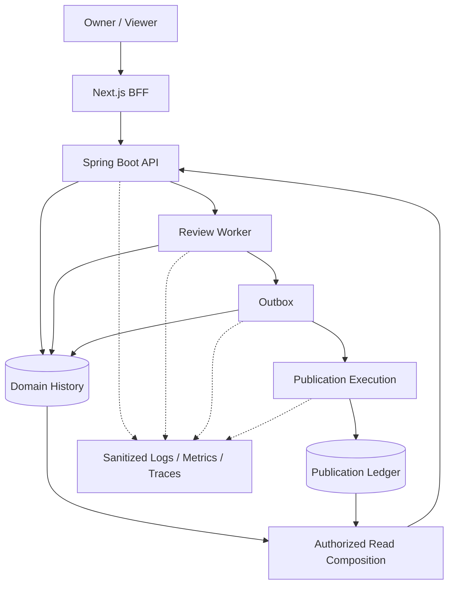

# 05 — Testing & Observability Architecture v0.1
**Approval:** OWNER APPROVED, 2026-10-18, architectural direction.
**Provenance:** Recovered from the assistant-authored M00-03 review and the Owner's explicit approval in conversation. This is a structured transcript-style recovery, not independently verified original standalone document.
**Deferred:** Tool versions, CI cadence, telemetry backend/TTL, numerical AI quality gates.

## 1. Three separate types of evidence
1. **Domain Execution History — source of business truth:** Review states, ownership, publication decisions, durable transitions. Persisted under domain module ownership and RET policies.
2. **Operational Telemetry — diagnostics:** Sanitized logs, metrics, tracing for timeouts, crashes, retries and bottlenecks. Not a replacement for state/ledger.
3. **Human & AI Evaluation — review quality:** Independent ground truth, false positives, precision/recall, grounding, model/prompt regressions.

An HTTP timeout after a GitLab write does not prove GitLab rejected it. Publication Ledger plus remote reconciliation is authoritative; logs are diagnostic.

## 2. Testing layers

| Layer | Objective | Candidate |
|---|---|---|
| Architecture Verification | Circular deps, module boundary leakage | Spring Modulith verification |
| Unit | Domain rules and state transitions | JUnit 5, Mockito |
| Module Integration | Contracts and transactional behavior | Spring Modulith @ApplicationModuleTest |
| Persistence/Concurrency | Atomic claims, fencing, outbox/idempotency | PostgreSQL + Testcontainers |
| External Adapter Contracts | GitLab, Keycloak, Local AI errors | Controlled HTTP stubs/test instances |
| End-to-End | Owner/Viewer full workflows | Playwright |
| Fault/Recovery | Worker restarts, lost responses, cancellation, failure | Process-level fault injection |
| AI Evaluation | Quality and reproducibility | Versioned labeled datasets |

**Module invariants:** Review may not access Publication internals or uncontrolled GitLab write adapter. Evaluation cannot automatically authorize publication. Query Composition must not bypass module ownership/authz. Spring Modulith tests verify declared dependencies. Concurrency correctness must be tested against PostgreSQL, not inferred from mocks.

## 3. Required failure/recovery scenarios

| Scenario | Expected safe behavior |
|---|---|
| Worker crash before Review commit | No fake completed result; recovery possible |
| Crash after Review commit before handoff | Durable outbox intent remains recoverable |
| Duplicate Outbox delivery | Idempotent downstream admission |
| Expired lease + late Worker completion | Fencing denies stale commit |
| MR revision changes before publication | Review content blocked as stale/unverifiable |
| MR changes during multi-write publication | Stop subsequent writes when detected; preserve actual partial effects; residual race OPEN |
| GitLab accepted write but response lost | UNKNOWN/reconciliation; no blind POST retry |
| Some inline comments succeed and later ones fail | Per-finding outcome; PARTIAL state |
| Zero valid findings | Valid Review result; no claim code is bug-free; summary only if policy allows |
| Owner disables Auto-Publish | No new writes contrary to current policy |
| Integration removed | Jobs canceled/blocked, credentials/pending state removed per OPS-004 |
| Model JSON valid but fabricated evidence | Fail grounding/evidence validation |
| Prompt injection in MR diff | No command execution, credentials exposure or unauthorized GitLab action |

**TOCTOU caveat:** Checking MR SHA immediately before GitLab POST cannot guarantee an absolute race-free external write without a matching remote conditional API. Runtime investigation V-03 remains OPEN.

## 4. Independent AI quality evaluation
**Technical:** schema-valid output rate, file/line/evidence grounding accuracy, inspected diff/context coverage.
**Review quality:** precision, recall, false-positive rate, severity agreement.
**Operational:** inference duration, timeout/OOM rate, recovery success rate.

Human approval rate is not independent ground truth: users may reject true findings or accept false ones. Dataset must include known bugs, clean controls, regressions, incomplete context and prompt-injection cases. Evaluate model version/artifact, quantization, prompt version, context selection and validation config for reproducibility.

Auto-Publish default-off. Software tests passing alone is insufficient to activate it. Numerical quality thresholds are DEFERRED pending local benchmark and Owner approval.

## 5. Observability flows

### Sanitized structured logs
Suggested fields: event code, service, module, execution ID, attempt, reason code, trace ID, timestamp. These are operational metadata, not raw source/diffs/prompts, tokens, or model outputs. Never expose repository secrets through exceptions or trace attributes. Logs are not the recovery mechanism.

### Metrics
- Detection: poll duration, revisions admitted, failures.
- Review: queued/running, duration, timeouts/failure reasons.
- Worker: lease expiry, stale commit rejections, retry attempts.
- Outbox: pending count, oldest pending age, dispatch failures.
- Publication: published/blocked/partial/reconciliation backlogs.
- Local AI: latency, timeouts/OOM and output validation failures.
- Security: authentication and authorization denials.
- Infrastructure: JVM heap/GC, CPU, DB connections, GPU memory.

Avoid high-cardinality metric labels containing individual MR/review IDs. Use logs/domain records for detailed IDs.

### Distributed traces
Trace request → durable Review admission, Worker claim, GitLab context, local inference, validation, Review commit+Outbox, Publication admission, GitLab write and reconciliation. Asynchronous workflow IDs and ledger IDs are durable correlation anchors; trace IDs may be linked but do not establish business truth. Propagated trace context must not carry sensitive payload.

## 6. Full Review Observability and Viewer
Review Detail should show MR/revision/model metadata, selected/inspected files and limitations, durable execution timeline/retry reasons, findings/evidence, publication outcomes, Human Evaluation and recovery states.
Owner and Viewer read retained/sanitized business data under the Global Full Read-Only Amendment; Viewer cannot execute commands or access raw secrets. The UI may only display information lawfully retained; Full Observability is not unlimited raw prompt/source persistence.

## 7. Retention
| Category | Approved or deferred |
|---|---|
| Unapproved / selected-unpublished findings | 30 days meaningful Owner inactivity |
| Published finding content/evidence | 90 days from successful publication |
| Sanitized audit | 90 days |
| Minimal Publication Ledger | 365 days |
| Sanitized operational logs | 30 days |
| Temporary working source/diff/job context | Cleanup on completion/cancel/failure, crash scavenging |
| Detailed execution history | TTL DEFERRED |
| Human Evaluation details | TTL DEFERRED |
| Metrics/tracing storage | Backend/TTL DEFERRED |

Viewer reads, UI refresh and background polling must not reset the inactivity clock.

## 8. Tooling candidates and CI
JUnit 5/Mockito, Spring Modulith verification/tests, Testcontainers/PostgreSQL, WireMock alternative, Playwright, Spring Boot Actuator/Micrometer, JSON logging, OTel-compatible instrumentation. Prometheus/Grafana and Loki are OPTIONAL later, not M01 dependencies.
Jenkins is a planned DevOps learning target. Future CI stage candidates: fast/static/unit; integration; E2E; reliability/fault injection; AI evaluation; Compose/K3s deployment verification. Exact scheduling and suites-per-commit remain DEFERRED.

## 9. Proposed acceptance/evidence gates
| ID | Evidence needed |
|---|---|
| AT-01 | Module boundary verification passes |
| AT-02 | PostgreSQL concurrency/outbox/fencing passes |
| AT-03 | Duplicate/stale/partial/ambiguous publication verified |
| AT-04 | Owner/Viewer + Keycloak/BFF/API authorization verified |
| AT-05 | Finding evidence grounding & prompt-injection testing |
| AT-06 | Worker crash/restart recovery verified |
| AT-07 | Redaction, retention, cleanup and data leakage checked |
| AT-08 | Review lifecycle reconstructable from durable domain state/ledger |

No arbitrary test-coverage percentage is proof of AI quality or publication safety.

## 10. Approval record
2026-10-18 Owner explicitly: APPROVED Testing & Observability Architecture v0.1 **at architectural direction level**. Preserve domain-owned durable histories, Publication Ledger, multi-layer testing, fault/recovery verification, independent AI evaluation, sanitized telemetry and MD-10 retention/security. Exact tools/versions/CI schedules/telemetry stack+TTL/quality thresholds remain deferred.
